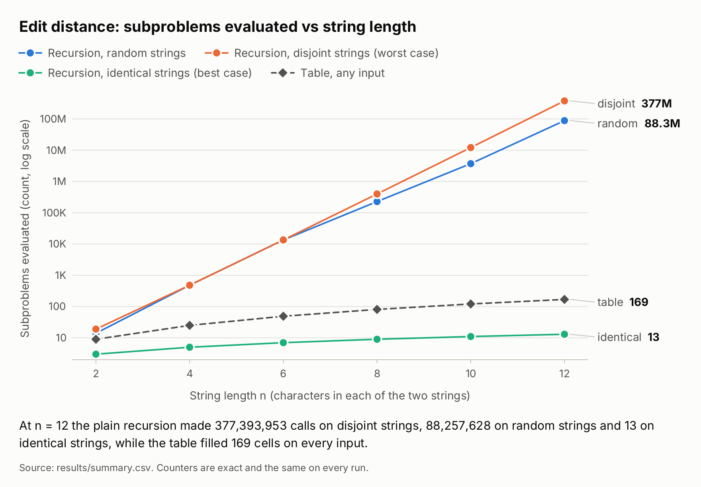
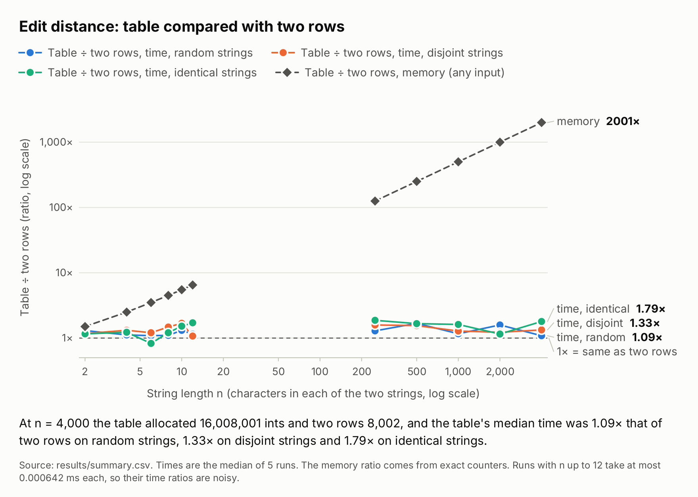
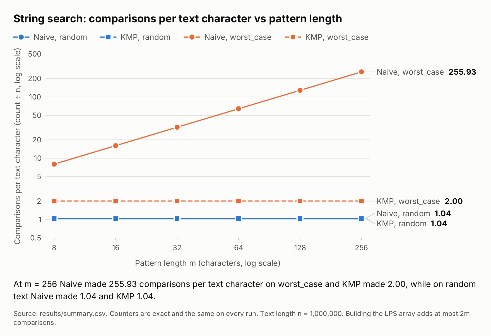
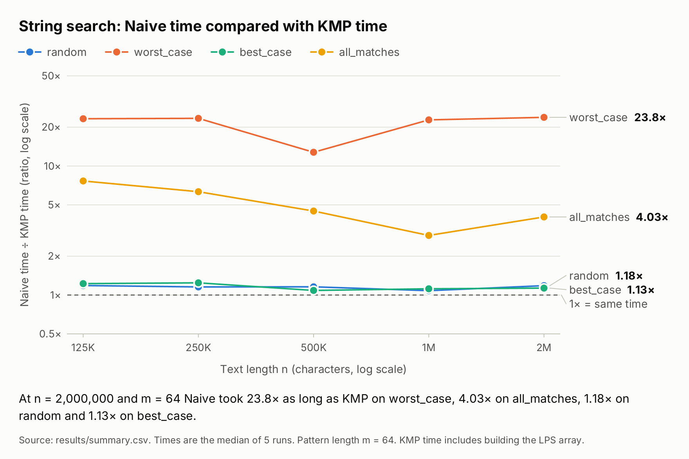

# Report: dynamic programming and string search

Nursultan Duisenbekuly, group SE-2524. DAA Assignment 4.

## 1. Experiment Design Card

This card, predictions included, was committed before the experiment was run for the first time (`git log` shows the order). Anything I change afterwards is listed in section 7 with the reason.

What holds for every row of both cards: random seed 42 (each case derives its own seed from it, so adding a case never changes the others), a JIT warm-up before timing, 5 timed runs per case, and the median goes into the plots. Counters come out identical on every run and on every machine. Times do not, so I never use a time as my only evidence. I picked the sizes from the formulas below, without a trial run.

### Edit distance

| Card field | What I wrote |
|---|---|
| Question | Does the work of the plain recursion blow up exponentially with the string length, while the table and two-row versions grow like n·m? And what do two rows save compared with the full table? |
| Sizes (n) | n = \|a\| = \|b\|. Recursive: 2, 4, 6, 8, 10, 12. On the worst input every extra character multiplies the number of calls by about 5.8. At n = 12 that is already about 377 million calls, and n = 14 would need about 30 times more, so I stop at 12 (12 / 2 = 6, above the required factor of 4). Table and two rows: the same six sizes, so all three versions share one axis, plus 250, 500, 1000, 2000 and 4000 (4000 / 250 = 16). At 4000 the table has 16 million cells (64 MB), which a default JVM heap holds easily. |
| Inputs | identical: a = b, the best case for the recursion because it only follows the diagonal. random: two independent random strings over a-z, the typical case. disjoint: a uses only a-m and b only n-z, so no two characters ever match. This is the worst case for the recursion. Table and two rows should cost the same on all three. I want to see that, not assume it. |
| Metrics | time_ms: median of 5 runs. It is what a user feels, but it depends on the machine. subproblems: recursive calls, or table cells filled. It counts the repeated work from Lecture 8 and is the same everywhere. memory_cells: ints allocated for the table or the rows. It is what separates the table from two rows. |
| Prediction | 1. identical: the recursion makes exactly n + 1 calls. 2. disjoint: (3·D(n,n) − 1) / 2 calls, where D(n,n) is the central Delannoy number. That is 377,393,953 at n = 12, and about 5.8 times more for each extra character. 3. random: about half of the disjoint count at n = 12 (I expect between 25% and 90%). 4. table and two rows: exactly (n+1)^2 subproblems on every input. Memory is (n+1)^2 cells for the table and 2(n+1) for two rows. 5. time: the recursion takes between 0.5 s and 5 s per call at n = 12 on disjoint strings. Table and two rows get about 4 times slower when n doubles and need 20 to 150 ms at n = 4000. Two rows is as fast as the table or up to twice as fast. |
| Plots | edit_distance.png: subproblems against n on a log axis, the recursion on all three inputs plus the table. Does the recursion blow up while the table does not? two_rows_vs_table.png: table ÷ two rows for memory and for time, against n (a ratio, log axis). What do two rows save, and does it cost time? |

### String search

| Card field | What I wrote |
|---|---|
| Question | Does Naive degrade to about n·m comparisons on a repetitive input while KMP stays within 2n? Does the difference show up on random text and on the clock? |
| Sizes (n) | n = text length, m = pattern length. Sweep A: n = 125,000; 250,000; 500,000; 1,000,000; 2,000,000 with m = 64 (largest / smallest = 16). Sweep B: n = 1,000,000 with m = 8, 16, 32, 64, 128, 256 (a factor of 32). Log files are long and patterns are short, so the text length is the main size. Sweep B tests the n·m claim directly. The heaviest case, Naive on the worst input at m = 256, is about 256 million comparisons, a second or two. |
| Inputs | best_case: text without 'z' and a pattern starting with 'z', so Naive fails at the first comparison of every start. random: random text over a-z with a random pattern planted five times, like a typical log search. worst_case: text a^n, pattern a^(m-1)b. Naive matches m − 1 characters at every start and then fails. This is also the nastiest input for KMP. all_matches: text a^n, pattern a^m. Every start is a match (n − m + 1 overlapping matches), so the output list is huge. |
| Metrics | time_ms: median of 5 runs. KMP's time includes building the LPS array. comparisons: text-vs-pattern character comparisons in the search loop, the usual cost model of Lecture 9. lps_comparisons: comparisons made while building the LPS array. memory_cells: ints in the LPS array (0 for Naive). |
| Prediction | 1. Naive comparisons: best_case n − m + 1; random about 1.04 per start position; worst_case and all_matches exactly (n − m + 1)·m. 2. KMP comparisons: best_case n; random between n and 1.1n; all_matches n; worst_case 2n − m + 1, which is almost its 2n bound. lps_comparisons is at most 2m. 3. On random and best_case, the time of Naive divided by the time of KMP is between 0.5 and 2. 4. On worst_case at n = 1,000,000 and m = 64, Naive is between 5 and 30 times slower than KMP. That is less than the comparison ratio of about 32, because one KMP step costs more than one Naive comparison. From m = 8 to m = 256 the ratio grows by a factor between 10 and 40. 5. On all_matches the ratio is smaller than on worst_case, because both algorithms have to build a list of about n matches. |
| Plots | string_search.png: comparisons per text character against m (log-log), Naive and KMP on worst_case and random. Does Naive's work per character grow with m while KMP's stays flat? performance_comparison.png: Naive time ÷ KMP time against n for m = 64, one line per input (a ratio, log axis). How much slower is Naive on the clock, and on which inputs? |

## 2. How I ran it

One run of `java -cp target/classes edu.daa.assignment4.experiment.Experiment` on a shared cloud container (2 vCPUs, Xeon at 2.3 GHz, OpenJDK 21) took 23 seconds and wrote 820 rows to `results/results.csv` (164 cases, 5 timed runs each) and their medians to `results/summary.csv`. The numbers below come from it unless I say repeat run or follow-up. A second run of the same command, in `results/repeat_run/`, shows how much the times move; I call it the repeat run. Every counter is a field that the algorithm increases itself, inside its loop or its recursive call.

## 3. Plots and results

*At n = 12 the plain recursion made 377,393,953 calls on disjoint strings, 88,257,628 on random strings and 13 on identical strings, while the table filled 169 cells on every input.*

*At n = 4,000 the table allocated 16,008,001 ints and two rows 8,002, and the table's median time was 1.09× that of two rows on random strings, 1.33× on disjoint strings and 1.79× on identical strings.*

*At m = 256 Naive made 255.93 comparisons per text character on worst_case and KMP made 2.00, while on random text Naive made 1.04 and KMP 1.04.*

*At n = 2,000,000 and m = 64 Naive took 23.8× as long as KMP on worst_case, 4.03× on all_matches, 1.18× on random and 1.13× on best_case.*

## 4. Prediction vs result: edit distance

| Prediction on the card | What I saw | Verdict |
|---|---|---|
| 1. identical: n + 1 calls | 3, 5, 7, 9, 11 and 13 calls at n = 2 to 12 | held |
| 2. disjoint: (3·D(n,n) − 1) / 2 calls, about 5.8 times more per extra character | exact at every size (377,393,953 at n = 12); the factor was 5.6 at n = 12 | formula held, 5.8 a bit high |
| 3. random: 25% to 90% of the disjoint count | 23.4% for my pair (88,257,628 calls); median 52.3% over 100 other pairs | missed with my pair, held for typical pairs |
| 4. table and two rows: (n+1)² subproblems on every input; memory (n+1)² and 2(n+1) | 169 at n = 12 and 16,008,001 at n = 4,000; memory 16,008,001 and 8,002 at n = 4,000 | held |
| 5. time: recursion 0.5 to 5 s at n = 12 on disjoint strings; table and two rows 4 times slower when n doubles and 20 to 150 ms at n = 4,000; two rows as fast as the table or up to twice as fast | 0.69 s; 4.0 times on average (2.9 to 6.4); table 38 to 64 ms, two rows 35 to 42 ms, so the table took 1.09 to 1.79 times as long | held |

The 5.8 is the limit of the ratio between consecutive central Delannoy numbers (3 + 2√2); at n = 12 it is still 5.6. The random miss is a flaw in my design: one pair per size is a thin sample, because a match makes the recursion call once instead of three times, and a match near the top of the call tree removes a large subtree. In the follow-up (section 7) 100 other pairs at n = 12 needed 17.6% to 100.0% of the disjoint count, with a median of 52.3% as the card said, and only 4 needed fewer calls than my pair. The prediction stays as written.

## 5. Prediction vs result: string search

| Prediction on the card | What I saw | Verdict |
|---|---|---|
| 1. Naive comparisons: best_case n − m + 1; random about 1.04 per start; worst_case and all_matches (n − m + 1)·m | at n = 1,000,000 and m = 64: 999,937; 1,040,543; 63,995,968 for both | held |
| 2. KMP comparisons: best_case n; random n to 1.1n; all_matches n; worst_case 2n − m + 1; LPS at most 2m | 1,000,000; 1,038,678; 1,000,000; 1,999,937; 63 to 125 LPS comparisons, where 2m = 128 | held |
| 3. random and best_case: time of Naive ÷ time of KMP between 0.5 and 2 | 1.08 to 1.24; repeat run 1.40 to 1.78 | held |
| 4. worst_case at n = 1,000,000, m = 64: Naive 5 to 30 times slower; the ratio grows 10 to 40 times from m = 8 to m = 256 | 22.8 times, repeat run 32.3; from 3.0 to 82.4 (27.1 times), repeat run 3.9 to 112.2 (28.9 times) | held; the first part missed in the repeat run |
| 5. all_matches: a smaller ratio than worst_case | 2.9 to 7.7 against 12.8 to 23.8; repeat run 2.1 to 6.9 against 29.6 to 32.3 | held, but noisy |

The comparison ratio at m = 64 is 63,995,968 / 1,999,937 = 32.0. I expected the time ratio to stay clearly below it, and the first run agreed but the repeat run did not. The dip to 12.8 times at n = 500,000 comes from one KMP median of 2.52 ms where its neighbours suggest 1.3 to 1.4 ms (repeat run: 1.10 ms); I do not know why. The all_matches times differ by up to 3.25 times between runs, probably from garbage collection while a list of a million Integers is built. Naive on worst_case at m = 256 took 0.23 s, not the one to two seconds I had guessed.

## 6. Short answers

*Which input made your string search slowest, and why does it do that?*
worst_case: text a^n, pattern a^(m-1)b. At n = 1,000,000 and m = 256 Naive made 255,934,720 comparisons, 256 per text character, and took 230 ms against 3 ms on random text. It matches m − 1 characters at every start, fails on the last one and moves on by one, so it rereads nearly the same characters. KMP is also at its worst here, with 2n − m + 1 comparisons, yet took 2.8 ms, because the LPS array lets it keep what it has matched. all_matches needs as many comparisons and took 258 ms, the extra probably going into storing a million matches.

*How large an n could the recursive Edit Distance handle, and what stopped it?*
I went up to n = 12, where two strings without a common character cost 377,393,953 calls and 0.69 s, against 169 table cells. Every extra character multiplies the calls by about 5.6, so at the measured 1.8 ns per call n = 14 would take about 22 s, n = 16 about 12 minutes and n = 18 about 6 hours (extrapolated, not run; the experiment code refuses n above 14). Time stopped it, not memory: the stack is at most 2n deep. The same pair (i, j) is solved again and again, 377 million times for only 169 different pairs.

*What do you gain and what do you lose when you use two rows instead of the full table?*
At n = 4,000 the table allocated 16,008,001 ints (64 MB) and two rows 8,002 (32 KB); the ratio is (n + 1) / 2, so the saving grows with n. Time was not the price: the table took 1.09 to 1.79 times as long as two rows (1.17 to 1.58 in the repeat run), perhaps because two short rows stay in the processor cache, which I did not measure. You lose the finished rows, so you get the number but cannot trace back which edits produced it, and the code is a little harder to read. Here distance() returns only a number, so nothing is lost.

*If you had to choose one string search for your city platform, which one and why?*
KMP. On random text the two were practically equal (Naive took 1.08 to 1.19 times as long), so KMP costs nothing there. Log files are often repetitive, and then Naive took 23.8 times as long at n = 2,000,000 and 82 times as long at m = 256 (n = 1,000,000), while KMP never needed more than 2n comparisons. I prefer that guarantee to hoping that nobody searches for aaaaab in a long run of a's. The price is m extra ints and a little more code; for a short street name Naive would do as well.

*One paragraph on time: what your measured times looked like and why they are not your only evidence.*
Times ran from 0.0001 ms (two rows, n = 2) to 0.69 s (the recursion at n = 12 on disjoint strings), none of them 0 ms, and where the work was large they followed the counters: from n = 8 on the recursion took about 30 times longer for every two extra characters, like its call count. They come from a shared two-core container, though. The same command run twice gave identical counters but different times: for the 116 cases above 0.05 ms the two medians differed by 1.10 times in the middle, 1.42 times at the 90th percentile and 3.25 times at most. That noise is the likely reason for the dip in the last plot, and it let one prediction pass in the first run and fail in the second (22.8 against 32.3, limit 30). The counters were identical and equal to their formulas, so they carry my claims about growth, and the times only show what this machine did on this day.

## 7. Changes to the card

I did not change the card. Section 1 is the text of commit `d779d1e`, and the misses are reported above instead of being edited away. After the first full run I added the repeat run, a follow-up on 100 other random pairs at n = 12 (`results/random_spread.csv`, code in `RandomSpread.java`) because my pair landed below my range, and a second drawing of the plots with larger text from `results/summary.csv` (`--plots-only`, no new measurements). Before the card I had written unit tests that compare the counters on small inputs with the formulas (commit `07c02b4`), but nothing was timed and no size sweep had run. The code, the tests, the plots and this text were written with an AI assistant (Claude); the README has the acknowledgement.
